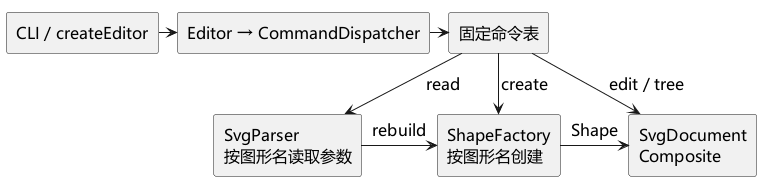
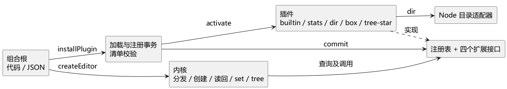

# Lab 1 Phase 2 · 插件实践与插件式重构

仓库 `En-cke/pj1`。Phase 1 兼容性基线为 `final`，Phase 2 提交版本为 `p2`。Word 版迭代报告见 [iteration-report.docx](iteration-report.docx)。早期实现及过程记录可通过 `git show final:doc/README.md` 查看。

## 运行与装配

在仓库根目录执行 `pnpm install --frozen-lockfile` 和 `pnpm build`。推荐使用 Node.js 22。

| 运行入口 | 装配方式 |
|---|---|
| `node dist/src/cli.js` | A。组合根在 `src/host/codePlugins.ts` 静态导入插件并传入各自的清单，便于类型检查和调试 |
| `node dist/src/cli.js --config plugins.config.json` | B。宿主通过 JSON 按配置顺序解析包、导入默认对象并激活 |
| `node dist/src/cli.js --baseline` | 仅注册 Phase 1 的 19 条命令和六种图形。空插件配置等效 |

```json
{
  "plugins": [
    { "module": "./dist/plugins/stats", "enabled": false },
    { "module": "./dist/plugins/box", "options": { "fill": "#f5a623" } },
    { "module": "./dist/plugins/tree-star" }
  ]
}
```

`module` 是包名、文件路径或含入口的包目录。相对路径以配置文件目录为基准，包名由以该配置文件为起点的 Node `createRequire(...).resolve` 解析，入口通过 `import()` 求值。外部包入口须支持该解析条件。仓库中的 TypeScript 样例经构建放入 `dist/plugins`，脚本同步复制其 `package.json`。装好的第三方 JavaScript 包可以直接写包名，无需改动加载器或应用源码。`enabled: false` 跳过解析，省略时启用。宿主把 `options` 原样传给 `activate(context, options)`，由插件校验。两种装配都按 stats → dir → box → tree-star 排列，默认 options 一致。

### 扩展点清单

内核契约由 `src/api.ts` 公开。四类实现以对象实例注册。注册发生在宿主的装配阶段，内核执行路径从注册表获取实例。

| 接口与职责 | 内核调用位置 | 实现和关闭可选插件时的行为 | 契约失败 |
|---|---|---|---|
| `ShapeProvider` 按类型创建并把 SVG 读回为领域对象 | `src/model/ShapeFactory.ts` 的 `create`、`providerFor` 和 `read`，由 `src/io/SvgParser.ts` 的 `parse` 选择并传入解析后的子节点 | builtin 的 `LeafProvider`、`GroupProvider` 提供六种图形，`BoxProvider` 提供 box。关闭 box 后，创建报未知类型，带标记的 g 读回为普通组 | 类型不存在时报 `unknown shape type`。返回对象的 id、类型或 SVG 标签不匹配时报 `invalid shape from provider`。插件可抛出参数或结构错误 |
| `Command` 提供名称、参数绑定和帮助 | `src/editor/CommandDispatcher.ts` 的 `dispatch`，`src/editor/Editor.ts` 的 `executeLine` 执行实例并更新历史 | `BuiltinCommand` 注册 Phase 1 各命令。 `StatsCommand`、`DirCommand` 可单独开关。关闭时从 help 消失，分发返回 `unknown command` | 调用实例缺少执行方法或编辑实例缺少 undo/redo 时返回 `invalid command invocation`。参数与执行错误加 `error:` 前缀 |
| `TreeDecorator` 为一行返回一个后缀 | `src/command/TreeCommand.ts` 的 `execute` 组合后缀，`src/model/SvgDocument.ts` 的 `tree` 和 `appendTree` 逐行调用 | `BoxTypeLabel` 返回 `(box)`，`ModifiedStar` 返回 `*`。无标签时输出与 Phase 1 逐字节一致 | 空值省略。多行或非字符串返回 `invalid tree label`，抛出的错误由 Editor 显示 |
| `AttributeHandler` 给图形的指定属性附加领域行为 | `src/command/SetCommand.ts` 的 `apply` 查询 `handles` 并执行 `apply` | `BoxAttributes` 处理 box 的 fill 和 label。无匹配时回到图形原属性白名单，普通矩形拒绝 label | 多个处理器匹配时返回 `conflicting attribute handlers`。不合法的匹配结果或回执报属性契约错误。执行失败则恢复文档快照 |

注册表还会检查入口方法、名称、图形标签和命令帮助的基本类型。 `src/host/pluginLoader.ts` 报告注册或加载错误，后续插件继续加载。

## 架构对比

| Phase 1 | Phase 2 |
|---|---|
| 启动代码拼装命令分发器、图形工厂和文件 IO。分发器拥有固定命令表，工厂和 SVG 解析器分别按类型分支 | 组合根把实现交给加载器，经清单校验后注册。分发、创建和读回通过注册表与接口调用 |
| `set` 直接委托图形白名单。树渲染器直接写图形摘要 | `set` 先匹配处理器。树渲染器接受通用行后缀回调。两条路径保留 Phase 1 默认输出 |
| 编辑命令以文档快照实现 undo/redo，容器递归处理子图形 | 复用快照及 Composite，增加提交前结构校验以及成功 read/save 后的保存点快照 |

依赖图同时提供 PlantUML 源文件和渲染结果。





[Phase 1 PlantUML 源码](architecture-phase1.puml) · [Phase 2 PlantUML 源码](architecture-phase2.puml)

### dir 的适配器

`DirectoryAccess` 是命令依赖的目标接口。`DirCommand` 是客户端，取得 `currentDirectory()` 后调用 `entries(path)`。`NodeDirectoryAccess` 是对象适配器，封装被适配的 `process.cwd()` 和 Node `fs.promises.readdir`，并把 `Dirent` 转换成领域输入 `{name, directory}`。代码装配与配置装配均使用同一默认 `DirPlugin`，单测可注入替身。目录优先，组内采用与区域设置无关的字符串顺序；符号链接及其余非目录项统一显示为 `[FILE]`，不追踪目标。命令类型为 `view`，因此可在 init/read 前使用，执行成功或目录读取失败都保留编辑历史。

`stats` 也属于 `view`。它按子节点顺序进行深度优先遍历，依初次遇见的叶子类型排序。普通组和 box 都作为容器，画布根不计入。

## ADR

### ADR 01 · 属性匹配、回执和编辑事务

`handles(shape, attr)` 只查询实例类型和属性名。处理器通过公开的 Shape/ContainerShape API 拿到与目标关联的子部件。BoxAttributes 使用 `part()` 取得由 id 派生的矩形和文字，通过 `setAttribute` 修改。可选回执用来提供执行与撤销文案。零匹配走原白名单，唯一匹配执行一次，多个匹配先拒绝再修改。 `EditingCommand.execute` 在应用前克隆文档，应用后验证结构并保存后快照，Editor 只在命令成功后改动历史。失败时恢复前快照，undo/redo 分别恢复整份前后快照，覆盖一条命令修改多个子部件的情形。

### ADR 02 · 复合图形标记与结构

`box` 序列化成带 `data-kind="box"` 的 `g`，必需的两个直接子件为 `<id>-rect` 和 `<id>-label`。创建时使用注入的图形创建函数取得矩形和文字，整棵子树的 id 在插入前检查。已注册 box provider 时，缺少必需件或件类型错误会拒绝整个读入。未装 box 时，标记交给普通 g provider 降级，保留支持的子树，后续保存输出普通 g。重复 id 由解析器预留显式 id 时拒绝。适用于所有形状的 `validate()` 在编辑提交前检查不变量，因此删除、重新分组或移动归属导致必需件脱离的操作会回滚。 `ungroup` 通过容器的能力契约拒绝 box，可整体移动、重排和删除。默认 fill 为 `#4a90d9`，标题位置沿用示例模板 `x+20` 和 `y+h/2+5`。

### ADR 03 · 保存点与树标签顺序

dirty 按当前内容是否偏离最近成功 read/save 的快照判断。init 后无保存点，根行和新建节点立即标星。整棵树的根行比较序列化内容。非根行比较自身内容、父 id 和自身直接子节点的 id 顺序。叶子属性修改不会向祖先组行传播，容器子列表的增删与排序属于容器自身变化。标签无缓存或模块状态，undo 回到保存点后星号消失。渲染器按注册顺序拼接，默认同一行显示 `(box) *`。

### ADR 04 · 清单校验与注册回滚

`package.json` 的 `contributes` 提供 `shapes`、`commands`、`decorators`、`attributes` 等名称数组，缺省类别为空。 `installPlugin` 让插件先向独立的暂存注册表提交实例。激活返回后逐类比较声明与实际名称集合，再一次合并。重复名称、非法贡献、激活抛错或清单不一致都会丢弃整批暂存，已提交的其他插件保留。上下文在激活流程结束后关闭。配置损坏时仍保留内置插件，模块求值或传递依赖出错报告激活失败。代码装配直接传同一清单与实例，配置装配只负责找到入口和清单。

## VS Code 扩展验证

进入 `vscode-extension`，执行 `npm ci`、`npm run build`。用 VS Code 打开该目录并按 F5，选择 **Run SVG extension**。在扩展开发宿主打开 `demo/example.svg` 的文本编辑器，展开 Explorer 的 Outline。 `npm test` 运行嵌套、匿名元素、精确范围、编辑和不完整 XML 的自动化测试。

VS Code 托管原生 Explorer 和 Outline，负责调度提供器、渲染装饰与跳转。扩展在激活时注册 `FileDecorationProvider` 与 `DocumentSymbolProvider`，由宿主按文件 URI 和当前文本快照调用。装饰提供器通过文件系统检查 FileType，返回独立的 `FileDecoration` 元数据；宿主在原来的 Explorer 项上叠加标记。经典 Decorator 以相同接口包装组件并委托，本实践通过宿主与 provider 组合实现附加职责。大纲端是适配器，将 XML 嵌套和字符偏移转换成 `DocumentSymbol`、`Range`，由 VS Code 对接导航。Phase 1 的 Composite 遍历思路可复用，其解析按 CLI 支持类型筛选元素并为匿名节点补 id，不含源码范围。扩展采用 saxes 事件构造源码树，保留匿名节点和编辑时偏移。 [VS Code Extension API](https://code.visualstudio.com/api/references/vscode-api)

在 Windows 上用 VS Code 1.148.0 验证。基线仅使用随 VS Code 提供的功能，大纲显示找不到符号。启用扩展后，`example.svg` 有 `[]`，同后缀目录 `assets.svg` 和 `notes.txt` 没有装饰。点 `rect#start` 到第 3 行，匿名 `text` 和二级容器 `g#next` 同时出现。对副本编辑 id 后大纲刷新，删除 `</svg>` 的右尖括号后大纲清空，撤销后恢复。测试前后的仓库示例文件内容相同。

| 实际运行证据 | 观察 |
|---|---|
| [基线](images/vscode-native-baseline.png) | 外部扩展关闭时无符号 |
| [文件标记](images/vscode-badge.png) | 比较 SVG 文件、同名后缀目录和文本文件 |
| [大纲与定位](images/vscode-outline.png) | 原生大纲的嵌套和第 3 行定位 |
| [编辑更新](images/vscode-edited.png) | 未保存的 id 更新到大纲 |
| [异常 XML](images/vscode-incomplete.png) · [恢复](images/vscode-recovered.png) | 清空与重新构建 |

## CLI 验收与指标

`pnpm check` 编译运行代码，执行 CLI 单元与集成测试、动态加载器测试及命令回放。单测可用 `pnpm exec vitest run test/commands.test.ts test/box-unit.test.ts test/tree-star.test.ts` 独立运行。加载器使用实际隔离包，覆盖四类失败、重复名、跳过、options 和回滚。集成测试演练了 box 嵌套、往返、降级、重复 id、非法结构回滚和属性事务。 `dir` 同时用替身和固定临时目录验证。

`pnpm verify` 从 Git 的 `final` 读取 Phase 1 源码并复用安装的工具与依赖，按字节比较 stdout 和保存 SVG。 `doc/transcript` 中的 `cli-1.txt`、`cli-1-flow.txt` 和 `cli-2-box.txt` 分别取自 Phase 1 §6 和 §6.1 的两个版本。Phase 1 回放对照关闭新增插件的入口与空配置，两种装配也用一致的插件集合回放。额外的 cli-1-commands.txt 覆盖全部 19 条 Phase 1 内置命令。 `cli-2-commands.txt` 检查 `stats`、`dir`、帮助和历史。目录项预先固定，输出由父进程捕获。所有期望日志和 SVG 与输入分文件提交。

```sh
git diff --name-status 32fde4a^ 32fde4a
git diff --name-status 332a590^ 332a590
git diff 32fde4a^ 32fde4a -- src/api.ts src/command src/editor src/extension src/host/pluginLoader.ts src/io src/model src/parser plugins/builtin plugins/dir plugins/stats ':(exclude)plugins/box'
git diff 332a590^ 332a590 -- src plugins/builtin plugins/dir plugins/stats ':(exclude)plugins/box'
rg -n "import|require|switch" src/host/pluginLoader.ts
node scripts/metrics.mjs final p2
```

`32fde4a` 演示代码方式，运行差异只涉及新增 box 包和 `src/host/codePlugins.ts`。`332a590` 演示配置方式，运行差异只涉及新增同一 box 包和 `plugins.config.json`。两者都附独立插件测试与包清单。随后 `08e1f79` 在框架中引入通用回执契约，`b190597` 仅改 box 插件以匹配 §6.1 文案。代码装配与配置装配的最终行为由回放脚本再次核对。

[最终源码指标](../docs/metrics/README.md) · [首次框架指标](../docs/metrics/framework/README.md)

## AI 协作检查

- 用 `final` 的运行结果约束重构，保留了 Phase 1 的输出空格、错误文案、命令别名与历史限制。测试一度把扩展的 Node 测试收进 Vitest，修正后各自按独立入口运行。
- 审核 `dir` 补充了明确的组内排序，混合文件测试发现 `[FILE]` 后只有一个空格，修为规格要求的两个，并验证真实临时目录的结果。
- 对照 Phase 1 §6.1 时发现 box 的通用命令回执使用了 SVG 标签名。先把回执钩子作为通用框架改动提交，再让 box 提供所需文案，最后用 `final` 的回放检查内置输出。
- 对照 VS Code 实际界面，特意加入 `assets.svg` 目录以验证后缀过滤之外的 FileType 检查。用不保存的编辑与撤销验证 Outline 的刷新和恢复。
