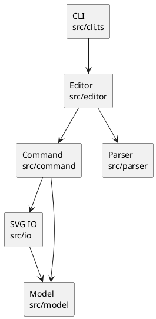

# SVG Editor CLI：设计与实现说明

## 架构方案

### 1. 模块划分

| 模块 | 目录 | 职责 |
|---|---|---|
| 图形领域模型 | `src/model` | 表达 SVG 文档、叶子图形和容器；负责几何操作、属性约束、树形展示与序列化 |
| 命令 | `src/command` | 将每一项用户操作封装成对象；编辑命令保存执行前后的文档快照以支持撤销和重做 |
| 编辑器应用层 | `src/editor` | 组装依赖、分发命令、维护 undo/redo 栈并控制 IO 后的历史规则 |
| 输入解析 | `src/parser` | 将带双引号的输入行切分为参数，同时识别空行和注释 |
| 文件 IO | `src/io` | 解析外部 SVG、补全 ID、读取和写入文件，隔离文件系统与 XML 依赖 |
| CLI 入口 | `src/cli.ts` | 提供 `svg>` REPL，只负责输入输出，不包含编辑规则 |
| 自动化测试 | `test` | 从命令行接口层面验证完整会话、异常原子性和 SVG 往返 |

组件关系如下：



运行时主链路为：CLI 将一行文本交给 `Editor`；`Tokenizer` 生成 token；`CommandDispatcher` 只在一个位置完成“命令名到命令对象”的映射；命令再调用领域模型或文件服务。CLI 不知道图形细节，图形模型也不知道命令行和文件系统。

### 2. 设计模式的选择

#### Command 模式

`src/command/Command.ts` 定义通用命令接口，`CreateCommand`、`MoveCommand`、`GroupCommand` 等类分别表示一项操作。`CommandDispatcher` 负责创建命令，`Editor` 负责执行和记录命令。

所有可撤销命令继承 `EditingCommand`。执行前保存文档快照，执行成功后保存新快照；失败时恢复旧快照，因此“一条命令是一个 undo 单元”且失败不会污染状态。`undo` 恢复 before，`redo` 恢复 after。IO 命令不进入历史栈，并由 `Editor` 设置历史禁止标记。

这里选择快照式 Command，而不是给每种命令手写逆操作，原因是 `group`、`ungroup`、`delete` 会同时改变父子关系、位置和多个对象，快照更容易保证原子性。当前作业规模下内存开销可接受；若未来处理超大 SVG，可将快照替换为差量 memento，而不修改 CLI。

#### Composite 模式

`Shape` 是叶子和容器的共同抽象。`RectShape`、`CircleShape` 等是叶子；`ContainerShape` 同时是 `Shape`，内部持有子图形。`move`、`scale`、`set`、`delete` 面向共同抽象执行，容器通过递归将几何操作应用到全部子孙。

因此命令层不需要通过 `switch(tag)` 判断图形类型。容器嵌套、整组移动、整组缩放和整棵子树删除都自然落在 Composite 上。

#### Factory 模式

`ShapeFactory` 是唯一的“类型名到图形类”分派位置，负责校验 `create` 的参数并创建六种内置图形。类型分派没有扩散到命令、IO 或展示代码中。

这一位置目前仍使用 `switch(type)`，是架构方案中明确保留的待重构点。后续插件阶段可改为 `Map<string, ShapeProvider>` 注册机制；Phase 1 的 `box` 按要求不会被提前实现。

### 3. 依赖方向规则

依赖规则如下：

1. `model` 不依赖 CLI、命令、文件系统或 XML 库，它是最内层。
2. `io` 可以依赖 `model`，负责把 XML 转换成领域对象；`model` 不能反向依赖 `io`。
3. `command` 可以依赖 `model` 和抽象后的文件服务；具体图形不能依赖命令。
4. `editor` 可以依赖命令、解析器和模型，用于编排应用流程。
5. `cli.ts` 只能依赖编辑器组装入口，不直接修改文档和图形。
6. `test` 可以依赖所有被测模块，但生产代码不能依赖测试。

理由是让变化频率高的输入输出依赖稳定的领域模型。以后增加 GUI 或 agent 通道时可以复用 `Editor` 和 `Command`，不需要修改图形类；以后替换 XML 库时也只影响 `io`。

允许的按名字分派只有两处：`CommandDispatcher` 的命令注册表，以及 `ShapeFactory` 的图形类型分派。若其他模块出现 `switch(tag)`，视为违反依赖与多态规则的待处理项。

### 4. 变化点假设

1. **新增图形类型**最可能发生。当前为它保留统一 `Shape` 抽象和集中式 `ShapeFactory`；Phase 1 没有提前实现插件注册，因为本阶段只要求六种内置类型。
2. **新增交互通道**可能发生，例如 GUI、脚本或智能体。编辑规则被放在 `Editor` 和 Command 中，CLI 仅是适配层，可以复用核心。
3. **撤销策略**可能因大文档性能而变化。当前快照策略简单可靠；未来可以在 `EditingCommand` 内替换成差量记录，外部接口不变。
4. **SVG 属性集合**可能扩展。当前每个图形通过自己的 `setGeometry` 管理白名单，新增某一类型的属性不会影响其他类型。
5. **序列化后端**可能变化。文件读取集中在 `SvgParser` 和 `FileService`，XML 库没有进入领域模型。
6. **复杂 SVG 兼容性**可能提升。Phase 1 只解析要求中的六种元素和三个公共样式，不保留路径、滤镜、CSS 等超出范围的信息；这里有意不为未知 SVG 全量兼容预留复杂机制。

## 过程记录

### 1. 先明确范围，再继续实现

最初读取要求后，AI 很快建立了 TypeScript 工程骨架并起草模型。随后我要求先给出“功能、技术和环境”的项目规划，确认后才能开始构建。AI 立即暂停，把工程划分、实现顺序、测试方式和 Git 提交计划列出；我回复 `ok` 后才继续。这个调整明确了 `box` 属于后续阶段，避免了过度实现。

### 2. 中文路径下的依赖安装问题

首次执行 `npm install` 时，本机 npm 10 在包含中文的工程路径中执行 esbuild 安装脚本失败，报出 `ERR_INVALID_ARG_TYPE`，并留下不完整的 `node_modules`。检查环境后发现已经安装 pnpm，于是改用 pnpm 安装相同依赖。pnpm 安装成功，TypeScript 编译与 Vitest 均可运行。项目因此记录 `pnpm-lock.yaml` 和 `packageManager` 字段，README 也以 pnpm 为推荐方式。

### 3. 从过程式建议收敛到对象职责

实现初稿曾倾向于让命令代码判断 `rect/circle/line` 后直接修改属性。对照“禁止到处 `switch(tag)`”的要求后，将 `move`、`scale`、属性白名单、摘要和 SVG 输出全部下沉到各个 `Shape` 子类。命令只通过抽象 `Shape` 操作目标；容器则递归调用子对象，形成真正的 Composite。

### 4. 用失败用例纠正自动 ID

初版“自动补 ID”只检查已经读入文档的元素。新增测试构造了“匿名 rect 在前、显式 `rect1` 在后”的 SVG，暴露出匿名元素会抢占后续 ID。修正方式是解析前先遍历一次，预留所有显式 ID，再为匿名元素选择未被预留的编号。相同测试现在得到 `rect2`，同时重复显式 ID 会被拒绝。

### 5. 纠正 group 的相对顺序

初版 `group kept c a` 会按参数顺序得到 `c, a`，不符合“保持相对顺序”。补充回归测试后，修改为先取得文档深度优先顺序，再对待分组对象排序。因此参数用于表达选择集合，组内顺序仍以原文档为准。

### 6. 验证错误原子性

对 `set c1 href bad`、循环分组、非正缩放等失败路径，测试会在命令前后读取状态并比较。`EditingCommand` 还在异常时恢复 before 快照，避免未来某个复杂命令执行到一半才失败而留下部分修改。

## 一致性自查

### 1. 模块划分

实际目录与架构方案一致：`model`、`command`、`editor`、`parser`、`io`、CLI 入口和测试均已落地。原规划曾单列 `history` 目录，最终历史栈很小，放入 `Editor` 能减少无意义的包装；这一差异在此记录。若以后改成差量历史或持久化历史，再独立为模块。

“一类一文件”在生产代码中得到遵守。辅助类型与其唯一使用者放在同一文件，例如 `ParseResult` 与 `SvgParser`，没有形成公共数据袋。

### 2. 依赖方向

抽样检查结果：

- `src/model` 没有导入 `command`、`editor`、`io` 或 CLI。
- `src/io` 只导入 Node 文件 API、XML 库和领域模型。
- `src/command` 面向 `Editor`、`SvgDocument` 或 `FileService`，没有反向依赖。
- `src/cli.ts` 只导入 Node readline 与 `createEditor`。
- 除 `CommandDispatcher` 和 `ShapeFactory` 外，没有按名称进行业务分派。

未发现违反既定依赖方向的代码。

## 质量保证手段

### 静态检查

TypeScript 开启 `strict`、大小写一致性检查和 NodeNext 模块解析。执行：

```bash
pnpm run build
```

编译器会检查所有生产代码和测试代码。

### 自动化测试

Vitest 从 `Editor.executeLine` 驱动真实命令流程，目前覆盖：

- 默认及指定尺寸画布；
- 六种内置图形、`in` 子句和大小写敏感 ID；
- 容器递归移动与缩放；
- 属性白名单和失败后状态不变；
- `group`、`ungroup`、`addto`、`front`、`back`；
- 循环嵌套和顶层解组保护；
- undo、redo、撤销后新编辑清空 redo；
- IO 后禁止撤销；
- XML 字符转义和 SVG 保存/读回；
- 匿名元素自动 ID、显式 ID 避让；
- 注释、引号、未知命令和未实现的 `box`。

统一验证命令为：

```bash
pnpm run check
```

### 人工验收

`examples/flowchart.txt` 保存了要求中的两节点流程图命令。人工验收时逐行回放，检查 `tree` 层级、整组移动、撤销、文字修改和浏览器打开保存后的 SVG。最终还检查 Git 工作区干净、中文提交历史完整，以及 `final` 标签指向最终提交。
