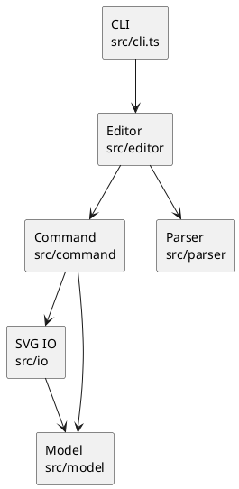

# PJ1 Phase 1 实验报告-24307130218-陈凯恩

## 一、实验目标与环境

本次实验实现一个 CLI 版 SVG 编辑器。程序通过命令行完成 SVG 文档的创建、读取、保存，以及基础图形的创建、移动、缩放、分组、删除、属性修改、结构查看和撤销重做。

开发环境如下：

- 操作系统：Windows
- 语言：TypeScript
- 运行环境：Node.js 22
- 包管理工具：pnpm
- XML 解析：`@xmldom/xmldom`
- 测试工具：Vitest
- 版本管理：Git

项目运行方法：

```bash
pnpm install
pnpm run cli
```

完整检查命令：

```bash
pnpm run check
```

## 二、架构方案

### 1. 模块划分

项目按照职责分成以下几个模块：

| 模块 | 目录 | 主要职责 |
|---|---|---|
| 图形模型 | `src/model` | 表示 SVG 文档、基础图形和容器，完成移动、缩放、属性修改、树形显示和序列化 |
| 命令模块 | `src/command` | 将每条用户操作封装成命令，并为编辑命令保存撤销和重做所需的状态 |
| 编辑器模块 | `src/editor` | 负责命令分发、文档状态和 undo/redo 历史管理 |
| 输入解析 | `src/parser` | 解析 CLI 输入、双引号字符串和注释 |
| 文件读写 | `src/io` | 负责 SVG XML 的读取、解析、自动补 ID 和写回文件 |
| CLI 入口 | `src/cli.ts` | 提供 `svg>` 交互提示符及脚本回放入口 |
| 测试 | `test` | 从命令接口验证功能和异常情况 |

各模块的关系如下：



程序的主要执行过程为：CLI 读取一行命令，`Tokenizer` 将输入拆分成 token，`CommandDispatcher` 根据命令名创建对应的 Command 对象，Command 再操作 `SvgDocument` 或调用文件服务。

### 2. 设计模式的选择

#### （1）Command 模式

本实验要求使用 Command 模式。代码中先定义统一的 `Command` 接口，再分别实现 `CreateCommand`、`MoveCommand`、`DeleteCommand`、`GroupCommand` 等命令类。

```typescript
export interface Command {
  readonly kind: CommandKind;
  execute(editor: Editor): Promise<string> | string;
}

export interface UndoableCommand extends Command {
  readonly kind: "edit";
  undo(editor: Editor): string;
  redo(editor: Editor): string;
}
```

所有可撤销的命令继承 `EditingCommand`。执行编辑前保存文档快照，成功后保存新的快照。如果执行过程中出现异常，则恢复执行前的状态。

```typescript
execute(editor: Editor): string {
  const document = editor.requireDocument();
  this.before = document.clone();
  try {
    this.result = this.apply(document);
    this.after = document.clone();
    return this.result;
  } catch (error) {
    document.restore(this.before);
    throw error;
  }
}
```

这样可以保证：

1. 一条编辑命令对应一个 undo 单元；
2. `group`、`delete` 等复杂操作也能整体撤销；
3. 命令失败后不会留下只完成一半的状态；
4. undo 后执行新编辑时，可以直接清空 redo 栈。

当前使用整份文档快照实现撤销，优点是逻辑简单且可靠。缺点是大文档下内存占用较高，后续可以在不改变命令接口的情况下改成差量记录。

#### （2）Composite 模式

图形和容器都继承抽象类 `Shape`。`RectShape`、`CircleShape`、`TextShape` 等是叶子节点，`ContainerShape` 内部保存若干子图形，同时它本身也是一个 `Shape`。

```typescript
export class ContainerShape extends Shape {
  private readonly items: Shape[] = [];

  move(dx: number, dy: number): void {
    for (const child of this.items) child.move(dx, dy);
  }

  scale(factor: number): void {
    for (const child of this.items) child.scale(factor);
  }
}
```

因此 `move`、`scale`、`delete`、`set` 等命令可以统一面向 `Shape` 操作。对容器执行移动或缩放时，操作会递归作用到全部子孙，不需要在命令中判断每一种图形类型。

#### （3）Factory 模式

图形创建集中在 `ShapeFactory` 中。它是唯一的“图形类型名到具体类”的分派位置，负责检查参数并创建 `rect`、`circle`、`ellipse`、`line`、`text` 和 `g`。

Phase 1 不实现 `box`。执行 `create box` 时按照要求返回：

```text
error: unknown shape type: box (is the plugin loaded?)
```

当前 `ShapeFactory` 中仍使用 `switch(type)`，这是保留的待重构点。后续插件阶段可以改成 `Map<string, ShapeProvider>`，使新图形通过注册加入，而不修改内核。

### 3. 依赖方向规则

项目规定以下依赖方向：

1. `model` 是最内层，不依赖 CLI、命令、文件系统或 XML 库；
2. `io` 可以依赖 `model`，`model` 不能反向依赖 `io`；
3. `command` 可以依赖 `model` 和文件服务，图形对象不能依赖命令；
4. `editor` 可以依赖命令、解析器和模型，用于组织应用流程；
5. `cli.ts` 只调用编辑器入口，不直接修改图形；
6. 测试可以依赖所有被测模块，生产代码不能依赖测试。

这样安排后，图形模型不受输入输出方式影响。以后增加 GUI 或智能体接口时，可以继续使用现有的 Command 和 Model；替换 XML 解析库时，也只需要修改 `io`。

按名字进行分派只出现在两处：

- `CommandDispatcher`：命令名到命令对象；
- `ShapeFactory`：图形类型名到图形对象。

其他模块没有使用 `switch(tag)` 判断图形类型。

### 4. 变化点假设

#### （1）增加新的图形类型

这是最可能发生的变化。当前保留了统一的 `Shape` 抽象和集中式 `ShapeFactory`。Phase 1 只实现要求中的六种类型，没有提前实现 `box` 插件。

#### （2）增加新的交互方式

后续可能增加 GUI、脚本或 agent 接口。CLI 只是最外层输入适配，编辑规则集中在 Editor 和 Command 中，因此新入口可以复用核心代码。

#### （3）修改撤销方式

当前使用快照保证正确性。如果 SVG 很大，可以把 `EditingCommand` 内部改成差量记录，外部调用方式不变。

#### （4）扩展 SVG 属性

每个图形类自己管理允许修改的属性。例如 `CircleShape` 只接受 `cx`、`cy`、`r` 和公共样式。增加某一类图形的属性时，不需要修改其他图形。

#### （5）支持更完整的 SVG

Phase 1 只解析六种要求内的元素以及 `fill`、`stroke`、`stroke-width`。`path`、滤镜和 CSS 等内容超出本阶段范围，因此暂时没有为完整 SVG 兼容增加复杂设计。

## 三、实验过程与实现

### 1. 建立图形模型

先实现 `Shape` 抽象类和六种内置图形。每个图形自己保存几何字段，并实现移动、缩放、属性修改、摘要显示、复制和 SVG 序列化。

随后实现 `ContainerShape` 和 `SvgDocument`。容器负责父子关系，文档负责全局 ID 查找、唯一性检查、分组、解组和层级调整。

### 2. 实现命令行解析

`Tokenizer` 逐字符处理输入，支持双引号中的空格。只有整行开头的 `#` 被视为注释，所以颜色值 `#ffffff` 不会被错误截断。

```text
create text title 20 40 "My Diagram"
create rect bg 0 0 800 600 #ffffff
```

CLI 同时支持交互输入和标准输入脚本回放。示例命令保存在 `examples/flowchart.txt` 中。

### 3. 实现编辑与历史功能

编辑命令统一继承 `EditingCommand`。`Editor` 保存 undo 和 redo 两个栈。执行普通编辑后，命令压入 undo 栈；执行 undo 后，命令移入 redo 栈；如果此时出现新编辑，则清空 redo 栈。

按照要求，`init`、`read`、`save` 和修改画布尺寸后禁止立即撤销。下一条编辑命令执行后重新开始记录历史。

### 4. 实现 SVG 读写

读取 SVG 时先构造一个临时文档。只有全部解析成功后才替换当前文档，因此错误文件不会破坏原状态。

对于没有 ID 的外部元素，程序先扫描并保留全部显式 ID，再给匿名元素分配编号，避免匿名 `rect` 抢占后面已有的 `rect1`。

```text
warning: assigned id rect2 to unnamed <rect>
```

保存时由各个图形对象多态生成自己的 XML，文本和属性值会进行转义。保存后的文件可以直接在浏览器中打开。

### 5. 典型运行过程

```text
svg-editor 0.1 — type 'help' for commands
canvas 800x600 created
g#flowchart created
g#node1 created in g#flowchart
rect#start created in g#node1
text#start-label created in g#node1
g#node2 created in g#flowchart
rect#process created in g#node2
text#process-label created in g#node2
line#arrow1 created in g#flowchart
g#node2 moved by (0,100)
node2 moved back by (0,-100)
text#process-label updated: text="处理数据 v2"
saved to flowchart.svg (8 elements)
```

结构树输出如下：

```text
svg (800x600)
└── g#flowchart
    ├── g#node1
    │   ├── rect#start  x=120 y=100 w=160 h=60 fill=#4a90d9
    │   └── text#start-label  (155,135) "开始"
    ├── g#node2
    │   ├── rect#process  x=520 y=100 w=160 h=60 fill=#f5a623
    │   └── text#process-label  (545,135) "处理数据"
    └── line#arrow1  (280,130) -> (520,130) stroke=black
```

## 四、与 AI 协作的过程记录

### 1. 先规划再实现

最开始读取要求后，AI 已经建立了 TypeScript 工程骨架，并起草了一部分模型。我发现还没有先确定完整方案，因此要求暂停实现，先列出功能、技术、环境、目录结构和 Git 提交计划。确认规划后再继续开发。

这一步明确了两个边界：本阶段必须实现 Command 模式和 Composite 语义；`box` 属于后续插件阶段，不能提前加入内核。

### 2. 调整图形职责

初步方案容易让命令代码根据 `rect`、`circle`、`line` 分别修改字段。对照要求后发现，这样会导致类型判断散落在多个命令中，不符合面向对象和多态要求。

因此把 `move`、`scale`、属性白名单、结构摘要和 SVG 输出放回各个 `Shape` 子类。命令只查找目标并调用统一接口，容器通过递归实现整体操作。

### 3. 修正匿名 ID 冲突

初版自动补 ID 只检查已经读入的元素。如果匿名 `rect` 在前，而显式 `rect1` 在后，匿名元素会先占用 `rect1`，随后产生重复。

我为这个情况增加了测试。修改后的解析器会先遍历一次，预留文档中全部显式 ID，再给匿名元素选择未使用的编号。测试中匿名元素最终得到 `rect2`。

### 4. 修正 group 的相对顺序

初版 `group kept c a` 会按照参数顺序得到 `c、a`，但要求是保持图形在原文档中的相对顺序。

修正后，分组前先取得文档的深度优先顺序，再对选中的图形排序。因此命令参数只决定选择哪些图形，组内顺序仍保持为 `a、c`。

### 5. 解决中文路径下的依赖安装问题

第一次执行 `npm install` 时，本机 npm 10 在中文工程路径中执行 esbuild 安装脚本失败，错误为 `ERR_INVALID_ARG_TYPE`。检查环境后发现已经安装 pnpm，因此改用 pnpm 安装同一组依赖。

pnpm 安装成功，TypeScript 编译和 Vitest 都能正常运行。项目中保留 `pnpm-lock.yaml`，并在 `package.json` 中记录包管理器版本。

### 6. 修正脚本回放问题

交互式 CLI 可以正常工作，但第一次通过管道回放 `examples/flowchart.txt` 时，`readline` 一次读取了后续多行，只有第一条命令真正执行。

后来根据 `stdin.isTTY` 区分两种情况：交互终端使用 `question` 循环，管道输入使用异步逐行读取。修改后完整示例可以一次回放成功。

## 五、一致性自查

### 1. 模块划分

实际目录与架构方案基本一致：

```text
src/
├── model/
├── command/
├── editor/
├── parser/
├── io/
└── cli.ts
```

原计划曾单独设置 `history` 目录。实际实现中历史管理只有两个命令栈和少量规则，因此直接放在 `Editor` 中，没有为了目录形式增加空包装。这一差异已记录，后续如果改成差量历史或持久化历史，再拆分为独立模块。

生产代码遵守一类一文件。`ParseResult` 等只服务于单个类的小型辅助类型与使用者放在同一文件，没有形成公共数据袋。

### 2. 依赖方向

抽样检查结果如下：

1. `src/model` 没有导入 `command`、`editor`、`io` 或 CLI；
2. `src/io` 只依赖 Node 文件 API、XML 库和领域模型；
3. `src/command` 面向 `Editor`、`SvgDocument` 或 `FileService`；
4. `src/cli.ts` 只导入 readline 和 `createEditor`；
5. 除 `CommandDispatcher` 和 `ShapeFactory` 外，没有按名称进行业务分派。

没有发现违反架构依赖规则的代码。

## 六、功能完整性与质量保证

### 1. 功能检查

| 类别 | 命令 |
|---|---|
| 文档 | `init`、`read`、`save`、`canvas` |
| 编辑 | `create`、`delete`、`move`、`scale`、`set` |
| 组合 | `group`、`ungroup`、`addto`、`front`、`back` |
| 显示 | `tree`、`show`、`help` |
| 历史 | `undo`、`redo` |

六种内置图形均已实现：`rect`、`circle`、`ellipse`、`line`、`text`、`g`。

### 2. 静态检查

TypeScript 开启 `strict`、大小写一致性检查和 NodeNext 模块解析。

```bash
pnpm run build
```

### 3. 自动化测试

测试从 `Editor.executeLine` 驱动真实命令流程，而不是只测试单个类。目前共有 14 个测试，覆盖：

- 六种图形和 `in` 子句；
- ID 唯一性和大小写敏感；
- 容器递归移动与缩放；
- 属性白名单和失败后状态不变；
- 分组、解组、移动归属和 z-order；
- 循环嵌套和顶层解组保护；
- undo、redo 和新编辑清空 redo；
- IO 后禁止撤销；
- SVG 保存、读回和 XML 转义；
- 匿名 ID 自动补全和显式 ID 避让；
- 注释、引号、未知命令和未实现的 `box`。

最终运行结果：

```text
Test Files  1 passed (1)
Tests       14 passed (14)
```

### 4. 人工回放

```powershell
Get-Content -Raw examples/flowchart.txt | pnpm exec tsx src/cli.ts
```

回放结果能够正确显示 8 个元素的结构树，完成容器移动、undo、文本修改和 SVG 保存。

### 5. Git 检查

项目按照功能逐步提交，提交信息使用中文。主要提交包括：

```text
搭建 TypeScript 项目骨架
实现基础图形与组合模型
实现命令调度与 SVG 编辑流程
补充核心功能自动化测试
完善分组顺序与 SVG 编号校验
支持命令脚本批量回放
完善架构说明与过程记录
```

最终版本使用 `final` 标签标记。

## 七、实验总结

本次实验完成了 CLI 版 SVG 编辑器的 Phase 1 功能。实现过程中主要处理了三个问题：如何用 Composite 统一图形和容器操作，如何用 Command 保证复杂操作能够整体撤销，以及如何保证外部 SVG 读入失败时不破坏当前状态。

最终代码中，图形行为放在领域对象内部，命令负责表达用户操作，Editor 负责应用流程，文件系统和 XML 解析被隔离在 IO 模块。测试不仅覆盖正常操作，也验证了重复 ID、循环嵌套、非法属性、自动编号冲突和 IO 后撤销等边界情况。

目前快照式 undo 和集中式图形工厂适合 Phase 1 的规模。后续如果进入插件化阶段，可以把图形工厂改为 Provider 注册表，并把历史记录改成差量方式。
